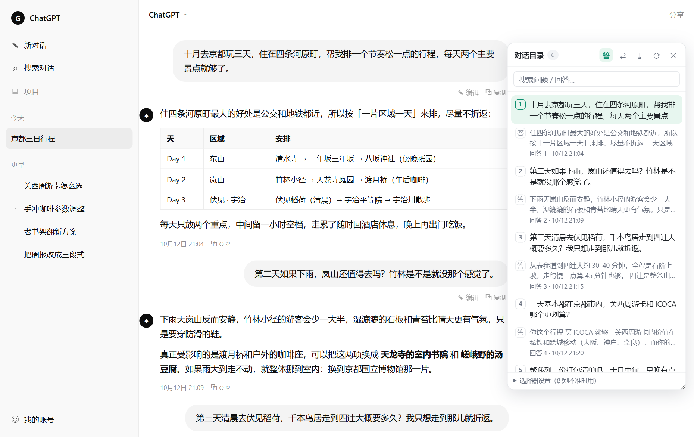

# 对话目录 · Chat Outline

[](https://github.com/fq188/chat-outline/actions/workflows/check.yml)


> 给 AI 对话网页加一个悬浮目录：随时看到这次对话里问过的每一个问题，点一下跳过去并高亮。

在长对话里翻找"那个关于单位换算的问题到底在哪"是最浪费时间的事。这个扩展把整段对话变成一份可点击的目录 —— 像 PDF 的书签，或代码编辑器的大纲。


*点第 3 条提问 → 页面平滑滚到那条消息，闪一圈绿色描边（截图来自本地仿真页面，演示数据）*



*点「答」把 AI 的回答也列进来，每条带 `回答 N · 时间` 的灰色小字*

---

## 功能

- **提问清单** —— 把整段对话里的提问按 1、2、3… 列出来，显示前两行
- **点击跳转** —— 平滑滚动到对应消息，并闪一圈绿色描边，一眼定位
- **滚动跟随** —— 你在页面上滚到哪儿，目录就高亮哪一问
- **搜索过滤** —— 输入关键词，回车直接跳到第一条命中
- **显示 AI 回答** —— 点「答」把回答条目（含时间戳）也列进来
- **导出 Markdown** —— 把问答全文导出成 `.md`，方便存档、写周报、贴进笔记
- **自动适配深浅色** —— 跟随页面主题，面板不刺眼
- **完全本地** —— 没有任何网络请求，不发一个字节出去

## 安装

这个扩展没有上架应用商店，用「加载解压缩的扩展」方式安装（这也是开发者模式的标准姿势）。

### Edge

1. 下载本仓库：`Code` → `Download ZIP`，解压到任意目录
2. 地址栏打开 `edge://extensions`
3. 打开左下角 **开发人员模式**
4. 点 **加载解压缩的扩展**，选择解压后含 `manifest.json` 的那一层目录
5. 打开 / 刷新任意 AI 对话页面即可（已打开的标签页需要刷新一次）

### Chrome

同理：`chrome://extensions` → 开发人员模式 → 加载已解压的扩展程序。

> 修改代码后，回到扩展页点该扩展的 ↻「重新加载」，再刷新网页。

## 使用

| 操作 | 说明 |
| --- | --- |
| `Alt + Q` | 显示 / 收起目录（点工具栏图标也行） |
| 点列表条目 | 跳转到该消息并高亮 |
| 序号徽章 | 第 N 个提问；打开「答」后 AI 回答显示为 `答` |
| 搜索框 | 支持中文/英文关键词，回车跳第一条 |
| 滚动页面 | 目录自动高亮当前阅读位置 |
| `答` | 显示 / 隐藏 AI 回答条目 |
| `⇄` | 面板换到屏幕另一侧 |
| `⤓` | 导出整段对话为 Markdown |
| `⟳` | 重新扫描页面 |
| 选择器设置 | 识别不准时手填 CSS 选择器，按域名记住 |

面板右下角可拖动调宽；收起后变成屏幕边缘一个小小的「目录」竖标签。窗口较窄时面板会自动收窄，不挤占正文。

| 搜索过滤（输入「下雨」，计数变成 `1/6`） | 自动跟随页面深浅色 |
| --- | --- |
|  |  |

## 支持的网站

**国内（16）**
豆包 · Kimi（kimi.com / moonshot）· DeepSeek · 腾讯元宝 · 通义千问（tongyi / qianwen）· 文心一言 · 智谱清言 · 讯飞星火 · 天工 · 秘塔 · 海螺 AI · 跃问 · 纳米 AI · 腾讯 ima · 百川

**国际（34）**
ChatGPT · Gemini · Google AI Studio · NotebookLM · Claude · Copilot · Grok · Perplexity · Poe · Le Chat (Mistral) · HuggingFace Chat · Qwen Chat · LMArena / Chatbot Arena · Meta AI · T3 Chat · OpenRouter · Phind · You.com · Pi · Duck.ai · Kagi Assistant · Genspark · Blackbox · Forefront

**科研 / 文献向（6）**
Elicit · SciSpace (typeset.io) · Consensus · ChatPDF · iAsk · Felo

完整域名清单见 `manifest.json` 的 `matches`（共 62 条）。

## 工作原理

不同站点的 DOM 千差万别，所以识别做了**三级降级**，任何一级命中即可工作：

1. **站点硬适配**：已知站点用精确选择器（ChatGPT 用 `data-message-author-role` / `data-turn`，Gemini 用 `user-query`，Claude 用 `data-testid`…）
2. **通用选择器**：逐一尝试 30+ 种常见的「用户消息」标记（`data-role="user"`、`class*="human-message"`、`user-query` 等），并做可见性与文本长度校验，避免误匹配侧边栏历史记录
3. **结构启发式**：以「编辑 / Edit」按钮为锚点向上反推提问容器 —— 绝大多数 AI 产品都会给用户消息配一个编辑入口，这招对完全没适配过的站点也管用

命中第 2、3 级时面板标题旁会出现绿色小标签 **自动**，提示"这是自动推断的结构"，不准可用手填选择器纠正。


*在没有任何硬适配的站点上，靠 class 命名自动识别出的目录，标题旁标着绿色「自动」（仿真页面演示）*

实现上用 Shadow DOM 把面板与页面 CSS 彻底隔离，不修改页面任何内容；长对话用 `WeakMap` 缓存解析结果，只重算变化的那条消息。

## 已知限制

- **虚拟滚动**：ChatGPT 这类站点只渲染视口附近的消息，未挂载的历史抓不到。往上滚动加载更多后，目录会自动补全。
- **时间戳**：只有页面本身渲染了时间才会显示，扩展不会去猜时间。
- **A/B 测试**：各家前端常灰度发布，同一站点不同账号的 DOM 可能不同。识别不到时按 `Alt+Q` 打开面板，在「选择器设置」里手填选择器即可临时救急，也欢迎提 issue 附上 DOM 结构。

## 想加一个站点

1. `manifest.json` → `content_scripts[0].matches` 加一行，如 `"https://chat.example.com/*"`
2. 若站点结构特殊，在 `content.js` 的 `SITES` 表里加一条：

```js
'chat.example.com': {
  label: 'Example',
  user: '用户消息的 CSS 选择器',
  assistant: 'AI 回答的 CSS 选择器',
  container: (n) => n.closest('.turn') || n,   // 可选：跳转要高亮哪个容器
},
```

3. 存盘 → 扩展页点「重新加载」→ 刷新网页

选择器怎么找：右键某条提问 → 检查，在控制台用 `document.querySelectorAll('选择器')` 验证条数。

## 更新日志 / Changelog

### v1.2.0 — 扫描性能与健壮性优化 / Faster, steadier scanning

功能与 v1.1.0 完全一致，未新增任何权限。
Same feature set as v1.1.0 — no new permissions.

**性能 / Performance**

| 中文 | English |
| --- | --- |
| 扫描加「廉价签名」：DOM 文本没变就跳过可见性测量、克隆清洗与渲染，流式输出期间开销大降 | Each scan now computes a cheap signature: when the DOM text is unchanged, visibility measurement, clone-and-clean and re-render are skipped — a large saving while an answer streams in |
| 识别未命中的页面按 DOM 纪元缓存空结果，不再每 400 ms 重跑全部探测 | Pages where nothing is detected cache that empty result per DOM epoch instead of re-running every probe every 400 ms |
| 「编辑」按钮启发式的结果按按钮数打戳缓存，命中后不再每次扫描重算 | The Edit-button heuristic is cached and stamped by button count, so a hit is not recomputed on every scan |

**健壮性 / Robustness**

| 中文 | English |
| --- | --- |
| 后台标签页暂停扫描，回到前台自动补扫 | Scanning pauses in background tabs and resumes with a full rescan once the tab is active again |
| SPA 路由切换即时感知（`history` / `popstate` 钩子），轮询降为兜底 | SPA route changes are picked up immediately through `history` / `popstate` hooks; polling is now only a fallback |
| 长对话校验上限从 400 条提到 1000 条 | The long-conversation validation cap goes from 400 to 1000 messages |
| 点图标但页面未注入脚本时，图标显示 ↻ 角标提示刷新 | If the toolbar icon is clicked on a page where the script was never injected, the icon shows a ↻ badge prompting a refresh |

**界面与体验 / Look & Feel**

| 中文 | English |
| --- | --- |
| 暗色检测同时看 `html` 与 `body`；跳转高亮色跟随深浅主题；toast 跟随面板所在的一侧 | Dark-mode detection now inspects both `html` and `body`; the jump highlight follows the light/dark theme; the toast follows whichever side the panel is on |
| 开启「答」后，流式生成的回答会实时更新对应的目录条目 | With 答 (answers) enabled, a streaming reply updates its outline entry in real time |

### v1.1.0 — 首个公开版本 / First public release

62 个站点适配；悬浮目录、搜索过滤、滚动跟随、显示回答、Markdown 导出。
62 supported sites, with a floating outline, search, scroll-spy, answer entries and Markdown export.

## 开发与测试

`dev/` 下有一套 Playwright 测试，用四个仿真页面覆盖不同识别路径：

| 文件 | 用途 |
| --- | --- |
| `dev/mock.html` | 仿 ChatGPT 结构（测试站点硬适配） |
| `dev/mock-generic.html` | 只有「编辑」按钮的陌生结构（测试启发式） |
| `dev/mock-universal.html` | 靠 class 命名（测试通用选择器） |
| `dev/mock-empty.html` | 无对话页面（确认不会误弹） |

```bash
cd dev
npm install playwright-core
npx playwright install chromium

node test-all.js    # 四场景识别 + 跳转 + 搜索 + 导出
node test-narrow.js # 三种窗口尺寸下面板布局
node e2e.js         # 以 --load-extension 真实加载扩展跑一遍
```

## 隐私

- 无任何网络请求，不采集、不上报
- 只用 `chrome.storage.local` 保存面板开关、显示偏好和自定义选择器
- 不读取页面以外的任何数据，不申请 `cookies`、`tabs` 等权限

## 文件结构

```
manifest.json     扩展清单（Manifest V3）
content.js        识别引擎 + 面板 UI + 跳转 + 导出（全部逻辑在这里）
background.js     工具栏图标点击 → 切换面板
icons/            16 / 32 / 48 / 128 图标
tools/            图标生成脚本（纯 Python 标准库，无依赖）
dev/              Playwright 测试与仿真页面
docs/             截图
```

## English

**Chat Outline** is a Manifest V3 browser extension that adds a floating outline to AI chat sites (ChatGPT, Gemini, Claude, Copilot, DeepSeek, Kimi, Doubao, and 60+ more). It lists every question you asked in the current conversation; click one to smooth-scroll to it and highlight it. Also supports search, scroll-spy highlighting, showing assistant turns with timestamps, and exporting the whole conversation as Markdown.

Detection uses a three-tier fallback: exact per-site selectors → ~30 universal "user message" patterns → a structural heuristic anchored on the edit button. Everything runs locally; the extension makes no network requests.

Load unpacked: `chrome://extensions` (or `edge://extensions`) → enable Developer mode → Load unpacked → pick this folder.

## License

[MIT](LICENSE)
