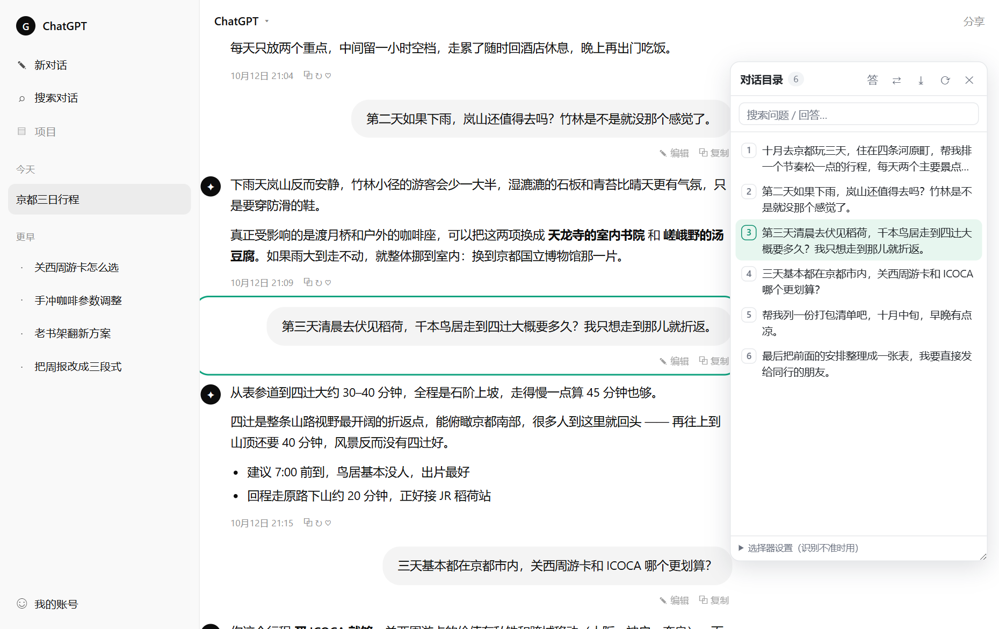
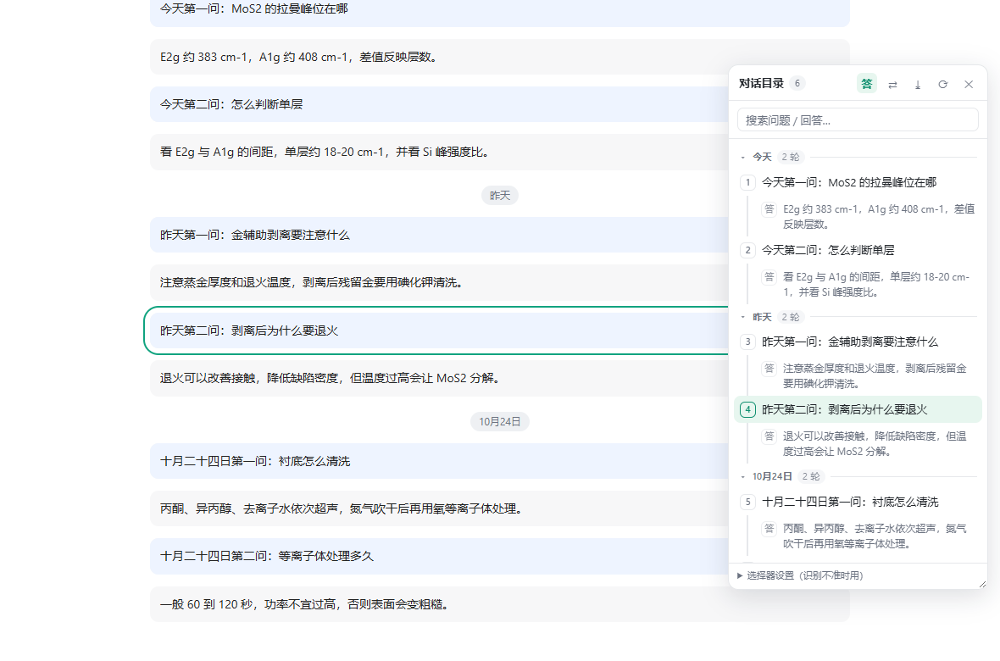
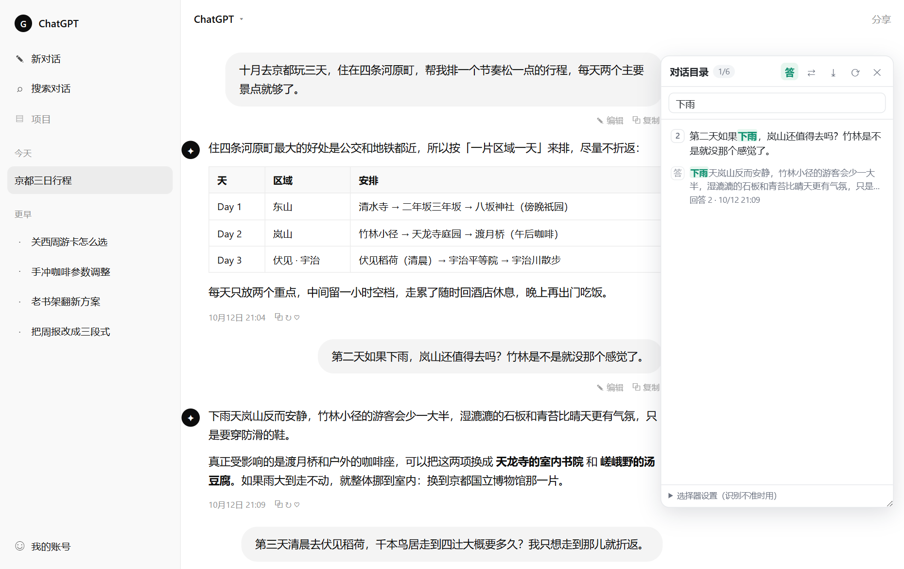
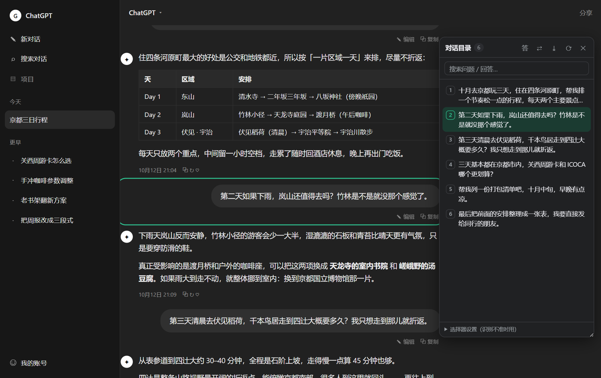
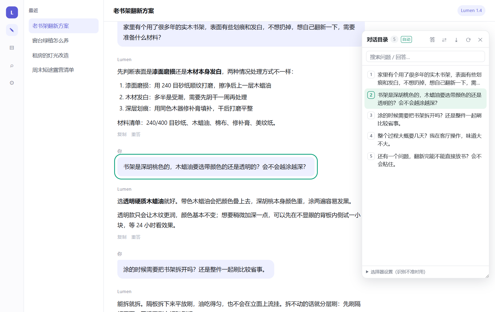

# 对话目录 · Chat Outline

[](https://github.com/fq188/chat-outline/actions/workflows/check.yml)


> 给 AI 对话网页加一个悬浮目录：随时看到这次对话里问过的每一个问题，点一下跳过去并高亮。

在长对话里翻找"那个关于单位换算的问题到底在哪"是最浪费时间的事。这个扩展把整段对话变成一份可点击的目录 —— 像 PDF 的书签，或代码编辑器的大纲。



*点第 3 条提问 → 页面平滑滚到那条消息，闪一圈绿色描边（截图来自本地仿真页面，演示数据）*



*按天分组（一级可折叠）→ 组内提问按编号串成一条脊线，回答缩进一行灰色预览；点「答」可只留提问*

---

## 功能

- **提问清单** —— 把整段对话里的提问按 1、2、3… 列出来，显示前两行
- **时间线分组** —— 按天分成一级标题（今天 / 昨天 / 10月24日），点标题即折叠；ChatGPT 上直接用会话数据里的时间戳，其他站点退回页面上的日期分隔条，实在没有就不分组，不留空标题
- **收起也知道里面是什么** —— 折叠起来的组头右侧会显示**这一组最后一问**的摘要（超出省略）
- **全部展开 / 全部收起** —— 搜索框下面一条细工具栏，一键收放所有分组，并显示「N 天 · M 轮」
- **回答也列出来** —— 每条提问下面跟一行灰色的回答预览，缩进两个字，和提问一眼分得开；想看纯清单就点「答」关掉
- **点击跳转** —— 平滑滚动到对应消息，并闪一圈绿色描边，一眼定位
- **滚动跟随** —— 你在页面上滚到哪儿，目录就高亮哪一问
- **搜索过滤** —— 输入关键词即时筛选并高亮命中词，回车直接跳到第一条命中；命中的分组会自动展开
- **导出 Markdown** —— 把问答全文导出成 `.md`，方便存档、写周报、贴进笔记
- **自动适配深浅色** —— 跟随页面主题，面板不刺眼
- **秒出目录** —— ChatGPT 上直接读站点自己的会话数据，一次请求拿全整段对话，不用等页面滚动加载（接口不通时自动退回滚动补扫）
- **不联网** —— 不向任何第三方发送数据；唯一的请求打向站点自己的域名，用的是你本来就登录着的身份

## 安装

这个扩展没有上架应用商店，用「加载解压缩的扩展」方式安装（这也是开发者模式的标准姿势）。

### Edge

1. 下载本仓库：`Code` → `Download ZIP`，解压到任意目录
2. 地址栏打开 `edge://extensions`
3. 打开左下角 **开发人员模式**
4. 点 **加载解压缩的扩展**，选择解压后含 `manifest.json` 的那一层目录
5. 打开 / 刷新任意 AI 对话页面即可（已打开的标签页需要刷新一次）

### Chrome

同理：`chrome://extensions` → 开发人员模式 → 加载已解压的扩展程序。

> 修改代码后，回到扩展页点该扩展的 ↻「重新加载」，再刷新网页。

## 使用

| 操作 | 说明 |
| --- | --- |
| `Alt + Q` | 显示 / 收起目录（点工具栏图标也行） |
| 点列表条目 | 跳转到该消息并高亮 |
| 序号徽章 | 第 N 个提问；AI 回答显示为 `答` |
| 分组标题 | 点一下折叠 / 展开这一天；折叠状态按会话记住，刷新后还在；收起时右侧显示该组最后一问 |
| 分组工具栏 | 「全部收起 / 全部展开」一键处理所有分组（搜索时自动隐藏，因为那时强制全展开） |
| 搜索框 | 中文/英文关键词（大小写不敏感），命中词高亮，回车跳第一条 |
| 键盘操作 | Tab 聚焦后 Enter / 空格跳转（分组标题上是折叠），`↑` `↓` 在条目间移动 |
| 滚动页面 | 目录自动高亮当前阅读位置 |
| `答` | 显示 / 隐藏 AI 回答条目 |
| `⇄` | 面板换到屏幕另一侧 |
| `⤓` | 导出整段对话为 Markdown |
| `⟳` | 重新扫描页面 |
| 选择器设置 | 识别不准时手填 CSS 选择器，按域名记住 |

面板右下角可拖动调宽；收起后变成屏幕边缘一个小小的「目录」竖标签。窗口较窄时面板会自动收窄，不挤占正文。

| 搜索过滤（输入「下雨」，计数变成 `1/6`） | 自动跟随页面深浅色 |
| --- | --- |
|  |  |

## 支持的网站

**国内（16）**
豆包 · Kimi（kimi.com / moonshot）· DeepSeek · 腾讯元宝 · 通义千问（tongyi / qianwen）· 文心一言 · 智谱清言 · 讯飞星火 · 天工 · 秘塔 · 海螺 AI · 跃问 · 纳米 AI · 腾讯 ima · 百川

**国际（34）**
ChatGPT · Gemini · Google AI Studio · NotebookLM · Claude · Copilot · Grok · Perplexity · Poe · Le Chat (Mistral) · HuggingFace Chat · Qwen Chat · LMArena / Chatbot Arena · Meta AI · T3 Chat · OpenRouter · Phind · You.com · Pi · Duck.ai · Kagi Assistant · Genspark · Blackbox · Forefront

**科研 / 文献向（6）**
Elicit · SciSpace (typeset.io) · Consensus · ChatPDF · iAsk · Felo

完整域名清单见 `manifest.json` 的 `matches`（共 62 条）。

## 工作原理

不同站点的 DOM 千差万别，所以识别做了**三级降级**，任何一级命中即可工作：

1. **站点硬适配**：已知站点用精确选择器（ChatGPT 用 `data-message-author-role` / `data-turn`，Gemini 用 `user-query`，Claude 用 `data-testid`…）
2. **通用选择器**：逐一尝试 30+ 种常见的「用户消息」标记（`data-role="user"`、`class*="human-message"`、`user-query` 等），并做可见性与文本长度校验，避免误匹配侧边栏历史记录
3. **结构启发式**：以「编辑 / Edit」按钮为锚点向上反推提问容器 —— 绝大多数 AI 产品都会给用户消息配一个编辑入口，这招对完全没适配过的站点也管用

命中第 2、3 级时面板标题旁会出现绿色小标签 **自动**，提示"这是自动推断的结构"，不准可用手填选择器纠正。



*在没有任何硬适配的站点上，靠 class 命名自动识别出的目录，标题旁标着绿色「自动」（仿真页面演示）*

实现上用 Shadow DOM 把面板与页面 CSS 彻底隔离，不修改页面任何内容；长对话用 `WeakMap` 缓存解析结果，只重算变化的那条消息。

## 已知限制

- **虚拟滚动**：ChatGPT 这类站点只渲染视口附近的消息。ChatGPT 上扩展会直接读会话数据，一次拿全；其他站点仍靠自动滚动补扫，**需要滚一遍页面**（对话越长越慢），几十条的对话大约几秒到十几秒。
- **未登录 / 接口变更**：读不到会话数据时不会报错，静默退回滚动补扫 —— 功能不缺，只是慢。
- **时间戳**：只有页面本身渲染了时间、或站点接口里带了 `create_time` 才会显示，扩展不会去猜时间。
- **改写消息**：编辑某条提问或重新发送之后，页面上被丢掉的那几轮会从目录里一起移除 —— 因为它们已经不属于这段对话了。
- **A/B 测试**：各家前端常灰度发布，同一站点不同账号的 DOM 可能不同。识别不到时按 `Alt+Q` 打开面板，在「选择器设置」里手填选择器即可临时救急，也欢迎提 issue 附上 DOM 结构。

## 想加一个站点

1. `manifest.json` → `content_scripts[0].matches` 加一行，如 `"https://chat.example.com/*"`
2. 若站点结构特殊，在 `content.js` 的 `SITES` 表里加一条：

```js
'chat.example.com': {
  label: 'Example',
  user: '用户消息的 CSS 选择器',
  assistant: 'AI 回答的 CSS 选择器',
  container: (n) => n.closest('.turn') || n,   // 可选：跳转要高亮哪个容器
},
```

3. 存盘 → 扩展页点「重新加载」→ 刷新网页

选择器怎么找：右键某条提问 → 检查，在控制台用 `document.querySelectorAll('选择器')` 验证条数。

## 更新日志 / Changelog

### v1.5.0 — 目录不用靠滚动加载了 / No more scroll-to-load

长对话里目录一直长不全，是因为 ChatGPT 只把视口附近那几条消息挂在页面上（虚拟列表），滚远了就卸载。以前只能靠「自动上下滚动一遍」把消息逼出来，几十条对话要滚十几趟、十几秒，屏幕还跟着跳。

这一版换了个办法：**直接向站点要这段对话的完整数据。**

**改进 / Improvements**

| 中文 | English |
| --- | --- |
| **一次请求拿全目录**：读取 `/backend-api/conversation/<id>`，沿 `current_node` 的 `parent` 一路回溯，就得到当前分支的完整线性对话。几十条对话通常 **1 秒内**全部进目录，不滚动、不闪烁 | **One request, whole outline**: the extension now reads `/backend-api/conversation/<id>` and walks `parent` back from `current_node`, giving the full linear thread of the current branch. A 50-message chat fills in **under a second**, with no scrolling and no flicker |
| **认证自动处理**：先取 `/api/auth/session` 的 `accessToken` 带上 `Authorization`，取不到就退回纯 Cookie 请求 —— 两条路都走不通才算失败 | **Auth handled for you**: it first grabs `accessToken` from `/api/auth/session` and sends it as `Authorization`; if that is unavailable it retries cookie-only. Only when both fail is the fast path considered dead |
| **失败静默回退**：接口 401、结构变了、8 秒没响应，都会**立刻**交回原来的滚动补扫，功能一点不少，只是慢回原来的样子（不会弹错误、不会卡住） | **Silent fallback**: a 401, a changed payload, or an 8-second timeout immediately hands control back to the original scroll sweep. Nothing breaks and nothing pops up — it is just as slow as before |
| **页面滚动次数从十几次降到 1 次**（实测：15 问的对话，旧方案滚动 11 趟，新方案 1 趟） | **Page scrolls drop from a dozen to about one** (measured: a 15-question chat took 11 scroll passes before, 1 now) |
| **接口条目与页面条目自动配对**：去掉「[图片 ×6]」这类方括号标注和空白后按「角色 + 文本前缀」双向匹配，页面滚到哪、哪条被卸载，目录里的位置都不变 | **API rows are matched to DOM rows**: after stripping bracketed markers like "[image ×6]" and all whitespace, rows are paired by role plus text prefix in both directions — so the outline never shifts no matter which messages the virtual list unmounts |
| **新消息会安静地补拉**：对话里冒出接口快照还没有的新提问时，会在后台再拉一次（最多 3 次），不打断你 | **New messages re-fetch quietly**: if a new question appears that the API snapshot does not have yet, the extension re-fetches in the background (up to 3 times) without interrupting you |
| **日期直接来自接口的 `create_time`**：分成「今天 / 昨天 / 前天 / 10月24日」，比解析页面分隔条更准 | **Dates come from the API's `create_time`**: grouped as Today / Yesterday / Day before / Oct 24 — more reliable than scraping on-page dividers |
| 提示只在确实省了事的时候出现一次：「已直接读取整段对话（N 条提问），不用滚动加载」 | The toast appears once, and only when it genuinely saved you work: "read the whole conversation (N questions) — no scrolling needed" |

**说明 / Notes**

| 中文 | English |
| --- | --- |
| 快速通道目前只对 **ChatGPT**（`chatgpt.com` / `chat.openai.com`）启用；其他站点没有稳定的公开接口，仍走滚动补扫，行为与 v1.4.0 一致 | The fast path is currently enabled for **ChatGPT** only (`chatgpt.com` / `chat.openai.com`). Other sites have no stable public endpoint and keep using the scroll sweep, exactly as in v1.4.0 |
| 只读当前分支：`parent` 回溯走的是你正在看的那条路径，不会把其他分支的旧提问混进来 | Only the current branch is read: walking `parent` follows the path you are actually looking at, so other branches never leak in |
| 不发任何数据到第三方，请求只打向站点自己的域名 | Nothing is sent to a third party; every request goes to the site's own domain |

### v1.4.0 — 目录结构收拾干净了 / A tidier outline

这一版没加新功能，专门解决「看着乱」：层级不一致、日期标签不可信、明明十几条却被折成几个空壳组头。

**改进 / Improvements**

| 中文 | English |
| --- | --- |
| **不再有「散条目」**：最前面那几条消息的日期分隔条常常还没渲染出来，以前它们就散在组外面，面板变成「几条散条目 + 几个组头」。现在它们统一归进「更早」组，结构永远是「组头 → 条目 → 组头 → 条目」 | **No more orphan rows**: messages at the very top often have no date divider rendered yet, so they used to float outside any group. They now go into an "Earlier" group, so the structure is always header → rows → header → rows |
| **日期标签只认可信写法**：`1/2`、`2/3` 这种裸的月/日不再被当成日期分隔条 —— 它们和分数、页码、题号长得一模一样，误伤率太高。真日期改由站点自己的 `<time datetime>` 提供，显示成「1月2日」 | **Only trustworthy date labels**: bare `1/2` / `2/3` are no longer treated as dividers — they look identical to fractions, page counters and question numbers. Real dates now come from the site's own `<time datetime>` and render as "Jan 2" |
| **日期标签中文化**：`Jun 3, 2025` → `2025年6月3日`，`2025-06-03` → `2025年6月3日` | **Localised date labels**: `Jun 3, 2025` and `2025-06-03` both render as `2025年6月3日` |
| **小对话不再自动折叠**：原来按「组数 > 3」判断，十一二条的对话也会被折成几个空壳组头；现在要超过 40 条才收起旧分组 | **No more auto-folding on short chats**: the old rule folded whenever there were more than 3 groups, so a 11-question chat collapsed into empty-looking bars. Folding now kicks in past 40 rows |
| **组内一条脊线**：提问的编号徽章串在同一条竖线上，层级一眼看得出来（回答不再单独画一条引导线，两条竖线紧挨着像画错了） | **A spine inside each group**: numbered badges sit on one vertical line so the hierarchy reads at a glance (answers dropped their own guide line — two lines side by side looked like a bug) |
| **回答只留一行预览**：目录是用来导航的，不是用来读的；一行灰色文字足够判断要不要跳过去 | **Answers are one-line previews now**: the outline is for navigating, not reading; one muted line is enough to decide whether to jump |
| **提问里的 LaTeX 噪声清掉**：`\(r=\frac12\)` 显示成 `r=1/2`，反引号、`\command` 一并去掉 | **LaTeX noise stripped from titles**: `\(r=\frac12\)` renders as `r=1/2`; backticks and `\command` are dropped |
| 图片消息的通用 alt（「用户附件」「uploaded file」）不再拼进标题，直接显示「图片 ×6」 | Generic image alt text ("user attachment", "uploaded file") is no longer glued into the title: it just reads "image ×6" |
| 条目上的时间只留时分 —— 组头已经写了日期 | Item timestamps keep only `HH:MM`; the date is already in the group header |

### v1.3.2 — 刚问出的问题一定落在最后 / New questions always land last

**修复 / Fixes**

| 中文 | English |
| --- | --- |
| 改了前面的消息、或者把同一句重新发一遍之后，**刚问的那句会显示在目录中间**，后面还跟着几条已经不在页面上、只在目录里「诈尸」的旧提问 | After editing an earlier message or re-sending the same question, **the new question showed up in the middle of the outline**, followed by old questions that no longer exist on the page |
| 原因：站点会给每条消息一个位置编号（`conversation-turn-N`），改写之后这个编号会被后面的消息重新占用。扩展按编号认人，就把新消息当成老消息「原地改字」，位置自然还是老的；被丢掉的那几轮也留在列表里 | Cause: the site gives each message a positional id (`conversation-turn-N`), and after an edit that id gets reused by a later message. The extension keyed messages by that id, so the new message overwrote an old entry in place and kept the old position, while the discarded turns stayed in the list |
| 现在改成「以页面上看到的先后顺序为准」：新条目按 DOM 里挨着谁落位；滚到底部时最后一条就是最新一条，排到它后面的旧分支残留会被清掉 | The outline now trusts the on-page order: new entries are placed next to whichever entry they are adjacent to in the DOM, and once you are scrolled to the bottom the last message is treated as the newest — leftovers from abandoned branches after it are dropped |
| 消息正文里出现 `1/2`、`今天` 这类短文本时，会被误认成日期分隔条，同一天在目录里被劈成两块（例如「今天 5 轮 / 1/2 1 轮 / 今天 3 轮」） | Short snippets like `1/2` or `今天` inside a message body were mistaken for date dividers, splitting one day into several groups in the outline |
| 日期分隔条现在只认长在消息外面的；另外加了一道「日期只会往前走」的校验，`今天 → 1/2 → 今天` 这种回退会被并回同一天 | Date dividers are now only accepted outside message bodies, plus a monotonicity check: a `today → 1/2 → today` regression gets merged back into one day |
| 面板原本贴在底部（正在看最新几条）时，新增提问后列表会跟着滚到底，不会停在旧位置看不到新条目 | If the panel was scrolled to the bottom, it now stays at the bottom after new questions arrive instead of leaving them out of view |

### v1.3.1 — 全部展开 / 收起 + 折叠组头的最后一问 / Fold-all and a peek line

**新功能 / Features**

| 中文 | English |
| --- | --- |
| 搜索框下面加一条细工具栏：左边「N 天 · M 轮」，右边一个按钮，有展开的就「全部收起」，已全收起就变「全部展开」 | A thin toolbar sits under the search box: "N days · M rounds" on the left, and a button on the right that reads **Collapse all** while anything is open and switches to **Expand all** once everything is folded |
| 折叠起来的组头右侧显示**这一组最后一问**的摘要（单行、超出省略），收起来也大概知道那天聊了什么 | Collapsed headings now show a one-line, ellipsised summary of **the last question in that group**, so a folded day still tells you what it was about |
| 摘要会去掉「昨天」「第二问：」这类前缀 —— 日期组头上已经写了，再来一遍很啰嗦 | The summary strips prefixes like "Yesterday" or "Question 2:" that would just repeat the heading |
| 搜索时工具栏按钮自动隐藏（那时所有分组本来就是强制展开的），只保留「N 天有命中 · M 轮」的统计 | While searching, the fold-all button hides (groups are force-expanded anyway) and the bar shows "N days with hits · M rounds" |

**说明 / Notes**

| 中文 | English |
| --- | --- |
| 折叠状态和以前一样按会话记住，点「全部收起」也会一起存下来，刷新后保持 | Folding is still remembered per conversation; "Collapse all" is saved too and survives a reload |

### v1.3.0 — 时间线分组 + 回答缩进 / Timeline groups and indented answers

**新功能 / Features**

| 中文 | English |
| --- | --- |
| 目录按**时间线分组**：从页面上找出日期分隔条（今天 / 昨天 / 10月24日），当作一级标题，每组显示「N 轮」，点标题折叠 / 展开 | The outline is now grouped by **timeline**: date separators on the page (Today / Yesterday / 24 October) become level-1 headings showing "N rounds", and clicking a heading collapses or expands it |
| 站点没有日期分隔条时，退回用它给的时间戳折成「M月D日」；两样都没有就不分组，绝不显示空标题 | With no date separators the site timestamps are folded into "M月D日"; with neither, no grouping is shown at all — never an empty heading |
| **回答默认列出来**（原来要手动点「答」）：每条提问下面跟一条回答，缩进两个字并加一条左侧引导线，提问是编号徽标、回答是「答」徽章 | **Answers are shown by default** (previously behind the "答" toggle): each question is followed by its answer, indented by two characters with a left guide line — numbered badge for questions, "答" badge for answers |
| 折叠状态按会话记住（`sessionStorage`），刷新后还在；跨 4 组以上时自动只展开最近一组，其余先收起 | Collapse state is remembered per conversation (`sessionStorage`) and survives a reload; with more than three groups only the most recent one starts expanded |
| 搜索时自动展开命中的分组（否则「命中了却看不见」）；清空搜索恢复原来的折叠 | Searching auto-expands groups with hits and restores the previous folding when the query is cleared |
| 点回答条目也能跳转并高亮；跳到折叠组里的条目会自动展开那一组 | Answers are clickable too; jumping into a collapsed group expands it first |
| 键盘：分组标题上 Enter / 空格折叠，`↑` `↓` 在条目间移动 | Keyboard: Enter / Space to fold a heading, `↑` `↓` to move between entries |

**修复 / Fixes**

| 中文 | English |
| --- | --- |
| 虚拟列表把日期分隔条一起卸载时，那几条会「没日期」把时间线切碎 —— 现在按目录顺序继承上一条已知日期 | When the virtual list unmounts a date separator, the following entries lost their date and split the timeline; they now inherit the last known date in document order |
| 一键面就误报「页面可能还有没加载出来的内容」：短对话（不到两屏）本来就不会虚拟化，现在直接跳过补扫；判定「收全了没有」也只认硬证据（序号有洞 / 从顶扫到底被打断） | A false "some content may not be loaded" toast appeared on open; conversations shorter than two screens are no longer swept, and "finished" now requires hard evidence (index gaps, or a pass interrupted before the bottom) |
| 回答条目的灰色小字原来重复显示「回答 N」，和「答」徽章说同一件事 —— 现在只留时间 | The answer meta line used to repeat "回答 N" next to the "答" badge; it now shows only the timestamp |

### v1.2.6 — 长对话一趟扫不完就接着扫 / Sweep resumes instead of giving up

**修复 / Fixes**

| 中文 | English |
| --- | --- |
| 很长的对话一轮补扫（14 秒预算）走不到底，旧版扫到一半就把「已补扫」标记置上，之后再也不会补 —— 目录永远停在一半。现在**记住停下的位置**，隔一秒接下趟继续，直到真的到底 | A very long thread does not fit in one 14-second pass; the old build marked the sweep as done at half-way and never retried, so the outline stayed permanently half-filled. The stop position is now remembered and the next pass continues from there until the end is reached |
| 最顶上那几条从来没采到：滚动后站点要过一会儿才渲染，采样早于渲染就采了个空。现在每一步都检查「挂载的条目换没换」，没换就再等一轮（最多两轮） | The first few entries were never collected: sites render slightly after the scroll, so sampling ran before the DOM updated. Each step now checks whether the mounted set actually changed and waits again (up to two rounds) if it did not |
| 刷新后目录虽然有缓存，却被「缓存已完整」的旧判断锁死，不再补扫 —— 这正是「刷新之后还是那几条」的原因。现在缓存只保证列表不空，要不要补扫交给位置信号决定 | After a reload the cached outline locked out further sweeps, which is exactly why a reload still showed only a few entries. The cache now only guarantees a non-empty list; whether to sweep is decided by the position signal |
| 「收全了没有」原来按位置判断，但补扫结束会把页面滚回原位，长对话必然停在底部、已挂载条目只盖住末尾，于是永远判定「没全」，白扫 8 趟。现在改为：**从顶部起的那趟确实走到了底 + 序号没有洞**才算收全 | Completion used to be judged by position, but every sweep restores the scroll, so a long thread always sits at the bottom with only the tail mounted — it looked incomplete forever and wasted eight passes. Completion now means: a pass started at the top actually reached the bottom, and there are no index gaps |

**体验 / Experience**

| 中文 | English |
| --- | --- |
| 补扫过程中目录会跟着一条条长出来（节流 0.7 秒），不用干等到最后才看到内容 | The outline now fills in as the sweep progresses (throttled to 0.7 s) instead of appearing all at once at the end |
| 实测 400 条消息（约 9.4 万像素高）自动分两趟收全，用时约 20 秒 | Measured on a 400-message thread (~94,000 px tall): fully collected in two passes, about 20 s |

### v1.2.5 — 判断「要不要补扫」不再靠高度比例 / Better sweep trigger

**修复 / Fixes**

| 中文 | English |
| --- | --- |
| 只有一两条很长、占满屏幕的对话时，已渲染高度占比看着「够了」，补扫压根不触发，目录就停在那几条。现在改成看**位置**：只要已挂载的条目没有铺满容器（上面或下面还空着），就说明有消息没挂载 | When a conversation is dominated by one or two very tall messages, the rendered height made it look "complete" and the sweep never ran, leaving only those few entries. The check now looks at **position**: if the mounted entries do not tile the container (space left above or below), content is missing |
| 补扫只在「序号有缺口」或「高度比例偏低」时才跑，漏了「上面一大段没挂载」这种最常见的情况 | The sweep only ran on index gaps or low height ratio, missing the most common case: a large unmounted stretch above |
| 选滚动容器时先确认「位置真的动过」，避免把某个不会滚的祖先当成对话容器，白扫一遍就放弃 | A candidate scroller must now actually move before it is accepted, so an inert ancestor no longer eats the only attempt |
| 缺口回访单个洞补不到就整体收手 → 改成连续三次失败才停 | Hole revisiting used to give up after a single failure; it now stops only after three consecutive failures |
| 补扫结果会写一份本地诊断（条数 / 序号范围 / 候选容器），排查时不用开 DevTools | Each sweep now records a local diagnostic (counts, index range, candidate scrollers) so issues can be diagnosed without DevTools |

### v1.2.4 — 补扫更稳：慢渲染、多滚动容器、会话缓存 / Steadier sweep

**修复 / Fixes**

| 中文 | English |
| --- | --- |
| 站点渲染比滚动慢时（超过 50ms）会整段漏掉：补扫原来每步固定等 50ms，现在改成「等 DOM 安静再采」，最多 420ms；到顶部还会多等 1.2 秒，给「异步加载更早的历史」留时间 | Fast sweeps used to skip messages on sites that render slower than the scroll (each step waited a fixed 50 ms). Each step now waits for the DOM to go quiet (up to 420 ms), and the top of the thread gets an extra 1.2 s for sites that fetch older history asynchronously |
| 「真正在滚的那个容器」不一定是消息最近的祖先：现在逐个尝试候选滚动容器，谁采到更多就用谁 | The element that actually scrolls is not always the nearest ancestor of a message; candidates are now tried in turn and whichever collects more wins |
| 扫完还有序号缺口时，换一半的步长再走一遍；仍补不齐就按序号比例逐个「洞」回访定位 | When gaps remain, a second pass with half the step size runs; if gaps still exist, each hole is revisited by index-ratio positioning |
| 刷新后又退回「几条」：目录现在按会话存进 `sessionStorage`，刷新立刻就是完整列表，不必重扫 | After a reload the outline dropped back to a handful of entries; the per-conversation list is now kept in `sessionStorage`, so a reload shows the full outline immediately |
| 补不齐时会明说「找到 24/30 条」，不再假装成功 | When it still cannot fill the gaps it says so: "found 24 of 30" |

**体验 / Experience**

| 中文 | English |
| --- | --- |
| 面板上的 ⟳ 除了重扫，也会触发一次整段补扫 | The ⟳ button now re-scans the whole thread, not just the current DOM |
| 切换对话不会带出上一段的缓存 | Cached entries never leak across conversations |

### v1.2.3 — 虚拟列表下也能列出整段对话 / Full outline on virtualized chats

**修复 / Fixes**

| 中文 | English |
| --- | --- |
| 长对话里目录只剩「我点开那条上下几条」：ChatGPT 这类站点用虚拟列表，滚远的消息会被卸载出 DOM，之前每次都按当前 DOM 重建目录，于是永远只有一小截 | On long chats the outline only listed the few messages around the one you clicked. Sites like ChatGPT use a virtual list that unmounts messages once you scroll away, and the outline was rebuilt from the current DOM every time — so it could only ever show that small slice |
| 目录改为「长期档案 + 稳定 key」：每次扫描并进去重，被卸载的条目留在列表里，顺序按文档位置维护 | The outline now keeps a persistent archive keyed by stable message identity: each scan merges into it, unmounted entries stay in the list, and order follows document position |
| 首次打开自动补扫一遍整段对话（从头滚到底再回到原位），条目从「几条」变成「全部」 | On first load it sweeps the whole conversation once (scrolls top to bottom, then restores your position), turning "a few entries" into "all of them" |
| 编号在虚拟列表下会错位（DOM 序号不等于第几问），改为按合并后的顺序重新数 | Entry numbers drifted under virtualization (DOM index ≠ question number) and are now recomputed from the merged order |

**体验 / Experience**

| 中文 | English |
| --- | --- |
| 点击当前不在 DOM 里的条目：先按记录下来的相对位置猜一屏，猜不中就在附近细搜，再不行从头线性扫一遍 | Clicking an entry that is not currently rendered now seeks it: it guesses from the recorded relative position, searches nearby, then falls back to a linear scan |
| 补扫期间你一动滚轮或按键就立刻中止并还原位置，不会跟你抢滚动 | If you scroll or press a key mid-sweep it stops immediately and restores your position |
| 切换对话时档案自动清空，不会串场 | The archive resets when you switch conversations |

### v1.2.2 — 图片消息与刷新后空目录 / Image-only prompts & empty outline after reload

**修复 / Fixes**

| 中文 | English |
| --- | --- |
| 只发图片、没有文字的提问以前会从目录里消失（文本为空即丢弃）；现在显示为 `[图片]`，图片带文件名时显示 `[图片：xxx.png]`，多张显示 `[图片 ×2]` | Image-only prompts used to vanish from the outline because empty text was dropped. They now show as `[图片]`, as `[图片：name.png]` when a filename is available, and `[图片 ×2]` for multiple images |
| 刷新页面后目录可能一直空白：初始化与首次扫描原先排在偏好读取之后，`chrome.storage` 回调不返回就再也不会扫描 | The outline could stay empty after a reload: initialisation and the first scan used to run after the preference read, so a storage callback that never returned blocked scanning entirely |
| 页面内容在 `MutationObserver` 挂载之前就渲染完时，不再依赖「后续还有 DOM 变动」才能出结果 | Content that rendered before the observer was attached no longer depends on a later DOM mutation to show up |

**健壮性 / Robustness**

| 中文 | English |
| --- | --- |
| 目录为空时按 300ms → 6s 退避补扫，最多约 30 秒；一有结果立即停止 | When the outline is empty it re-scans with 300 ms → 6 s backoff for up to ~30 s, and stops as soon as items appear |
| 在 `load`、`pageshow`（往返缓存恢复）时机各补扫一次 | Extra scans on `load` and `pageshow` (back/forward cache restore) |
| 偏好读取加 800ms 超时兜底，存储异常或扩展上下文失效不再阻塞初始化 | Preference reads now time out after 800 ms, so broken storage or an invalidated extension context no longer blocks initialisation |

### v1.2.1 — 高亮残留修复与键盘操作 / Highlight fixes & keyboard support

**修复 / Fixes**

| 中文 | English |
| --- | --- |
| 同一条消息连续跳转、或跳到另一条时，绿色描边可能残留不消失；现在复用最初样式并重置计时器，任意时刻只有一圈高亮 | Repeated jumps, or jumping to another message, could leave a stale green outline. The original styles are now reused and the timer reset, so exactly one highlight ring exists at a time |
| 下载被禁且环境没有 `clipboard` 时，导出会抛未捕获异常；现在只 toast 提示，有剪贴板时自动改为复制 | Export used to throw an uncaught error when downloads were blocked and no `clipboard` existed. It now only shows a toast, and falls back to copying when the clipboard is available |

**体验 / Experience**

| 中文 | English |
| --- | --- |
| 搜索命中的关键词在目录里高亮显示，大小写不敏感 | Search matches are highlighted in the outline, case-insensitively |
| 目录条目可用 Tab 聚焦，Enter / 空格即可跳转；图标按钮与搜索框补齐 `aria-label` | Entries can be focused with Tab and jumped to with Enter or Space; icon buttons and the search box now have `aria-label`s |
| 搜索无结果时按回车会给出提示 | Pressing Enter with no match now shows a hint |

### v1.2.0 — 扫描性能与健壮性优化 / Faster, steadier scanning

功能与 v1.1.0 完全一致，未新增任何权限。
Same feature set as v1.1.0 — no new permissions.

**性能 / Performance**

| 中文 | English |
| --- | --- |
| 扫描加「廉价签名」：DOM 文本没变就跳过可见性测量、克隆清洗与渲染，流式输出期间开销大降 | Each scan now computes a cheap signature: when the DOM text is unchanged, visibility measurement, clone-and-clean and re-render are skipped — a large saving while an answer streams in |
| 识别未命中的页面按 DOM 纪元缓存空结果，不再每 400 ms 重跑全部探测 | Pages where nothing is detected cache that empty result per DOM epoch instead of re-running every probe every 400 ms |
| 「编辑」按钮启发式的结果按按钮数打戳缓存，命中后不再每次扫描重算 | The Edit-button heuristic is cached and stamped by button count, so a hit is not recomputed on every scan |

**健壮性 / Robustness**

| 中文 | English |
| --- | --- |
| 后台标签页暂停扫描，回到前台自动补扫 | Scanning pauses in background tabs and resumes with a full rescan once the tab is active again |
| SPA 路由切换即时感知（`history` / `popstate` 钩子），轮询降为兜底 | SPA route changes are picked up immediately through `history` / `popstate` hooks; polling is now only a fallback |
| 长对话校验上限从 400 条提到 1000 条 | The long-conversation validation cap goes from 400 to 1000 messages |
| 点图标但页面未注入脚本时，图标显示 ↻ 角标提示刷新 | If the toolbar icon is clicked on a page where the script was never injected, the icon shows a ↻ badge prompting a refresh |

**界面与体验 / Look & Feel**

| 中文 | English |
| --- | --- |
| 暗色检测同时看 `html` 与 `body`；跳转高亮色跟随深浅主题；toast 跟随面板所在的一侧 | Dark-mode detection now inspects both `html` and `body`; the jump highlight follows the light/dark theme; the toast follows whichever side the panel is on |
| 开启「答」后，流式生成的回答会实时更新对应的目录条目 | With 答 (answers) enabled, a streaming reply updates its outline entry in real time |

### v1.1.0 — 首个公开版本 / First public release

62 个站点适配；悬浮目录、搜索过滤、滚动跟随、显示回答、Markdown 导出。
62 supported sites, with a floating outline, search, scroll-spy, answer entries and Markdown export.

## 开发与测试

`dev/` 下有一套 Playwright 测试，用四个仿真页面覆盖不同识别路径：

| 文件 | 用途 |
| --- | --- |
| `dev/mock.html` | 仿 ChatGPT 结构（测试站点硬适配） |
| `dev/mock-generic.html` | 只有「编辑」按钮的陌生结构（测试启发式） |
| `dev/mock-universal.html` | 靠 class 命名（测试通用选择器） |
| `dev/mock-empty.html` | 无对话页面（确认不会误弹） |
| `dev/mock-virtual.html` | 虚拟列表（只挂视口附近的消息） |
| `dev/mock-timeline.html` | 带日期分隔条的多天对话 |
| `dev/mock-append.html` | 追加提问 / 切分支 / 复用消息编号 |
| `dev/mock-mess.html` | 杂乱现场：日期分隔条缺失 + 假日期「1/2」+ 十几个组 |

```bash
cd dev
npm install playwright-core
npx playwright install chromium

node test-all.js    # 四场景识别 + 跳转 + 搜索 + 导出
node test-narrow.js # 三种窗口尺寸下面板布局
node test-v130.js   # 时间线分组、回答缩进、折叠
node test-v140.js   # 目录结构一致性（散条目 / 假日期 / 自动折叠）
node test-v132.js   # 新提问必须落在目录末尾（追加 / 切分支 / 编号复用）
node test-v150.js   # 快速通道：一次请求拿全目录，接口失败要退回滚动补扫
node e2e.js         # 以 --load-extension 真实加载扩展跑一遍
```

## 隐私

- **不向任何第三方发送数据**，不采集、不上报。唯一的请求发往站点自己的域名（ChatGPT 上读 `/backend-api/conversation/<id>`，用你当前登录的会话），目的是把目录一次拿全；接口不通时不做任何请求，退回纯页面解析
- 只用 `chrome.storage.local` 保存面板开关、显示偏好和自定义选择器
- 不读取页面以外的任何数据，不申请 `cookies`、`tabs`、`host_permissions` 等权限 —— 请求走的是 content script 的同源 `fetch`，没有额外授权
- 读到的对话内容只在当前页面内存里用，不写盘、不外传

## 文件结构

```
manifest.json     扩展清单（Manifest V3）
content.js        识别引擎 + 面板 UI + 跳转 + 导出（全部逻辑在这里）
background.js     工具栏图标点击 → 切换面板
icons/            16 / 32 / 48 / 128 图标
tools/            图标生成脚本（纯 Python 标准库，无依赖）
dev/              Playwright 测试与仿真页面
docs/             截图
```

## English

**Chat Outline** is a Manifest V3 browser extension that adds a floating outline to AI chat sites (ChatGPT, Gemini, Claude, Copilot, DeepSeek, Kimi, Doubao, and 60+ more). It lists every question you asked in the current conversation; click one to smooth-scroll to it and highlight it. Also supports search, scroll-spy highlighting, showing assistant turns with timestamps, and exporting the whole conversation as Markdown.

Detection uses a three-tier fallback: exact per-site selectors → ~30 universal "user message" patterns → a structural heuristic anchored on the edit button. Nothing is sent to any third party. On ChatGPT the extension reads the conversation from the site's own `/backend-api/conversation/<id>` so a long thread fills the outline in one go; everywhere else it parses the page only, and it falls back to page-only parsing whenever that endpoint is unavailable.

Load unpacked: `chrome://extensions` (or `edge://extensions`) → enable Developer mode → Load unpacked → pick this folder.

## License

[MIT](LICENSE)
